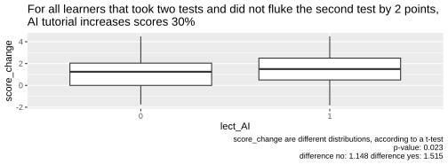
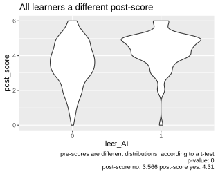
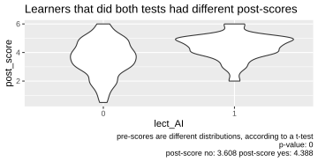

# Check

Here I check if the results of the paper holds
for different selection criteria.

Answer: yes. 

## Difference in pre-scores between the groups

## Difference in skill change between the groups

## Difference in post-scores between the groups

AI users had 33% higher grades.

If you look at the effect sizes:

Intervention   |Effect size
---------------|-----------
AI             |1.168
Active teaching|0.97

## Reference

Kestin, G., Miller, K., Klales, A., Milbourne, T., & Ponti, G. (2025). AI tutoring outperforms in-class active learning: an RCT introducing a novel research-based design in an authentic educational setting. Scientific Reports, 15. https://doi.org/10.1038/s41598-025-97652-6
